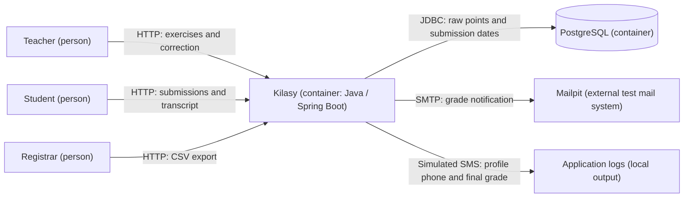

# Kilasy architecture — C1 and C2

This C4 container view documents the existing application. C1 adds a shared calculation inside the Spring Boot application; it introduces no new service or database schema.

Inside Kilasy, `SubmissionController`, `GradeReport` and `CsvExport` call `GradeCalculator`. The same final grade reaches the correction response, submission detail, email, transcript, average and CSV. PostgreSQL keeps raw points and dates; the penalty is calculated on each read. Mailpit captures development emails for inspection at `http://localhost:8025`.

See [ADR 0002](adr/0002-shared-late-penalty.md) for the calculation decision and [ADR 0001](adr/0001-port-postgresql-local.md) for the local port decision.

C2 injects the `SmsSender` interface into `SubmissionController`. Its development implementation, `LoggingSmsSender`, writes to the application logs. Provider errors are caught after publication, so the saved grade remains available. The provider owns the optional outage simulation switch. See [ADR 0003](adr/0003-simulated-sms-notification.md).
